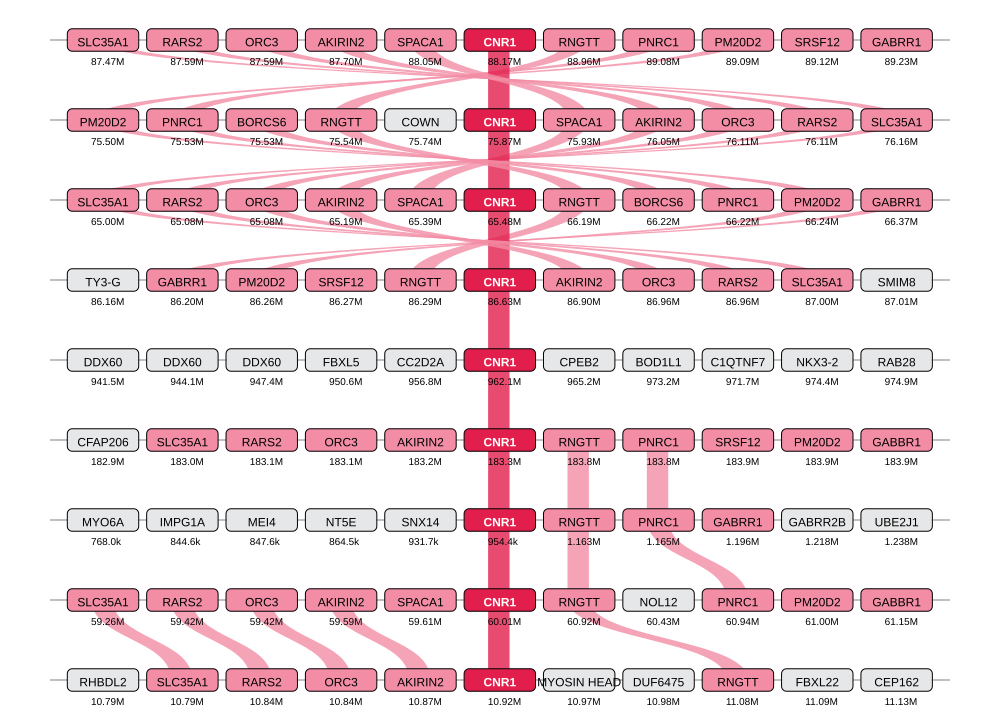

# Large-Scale Comparative Analysis Uncovers the Evolutionary History and Hidden Diversity of Lipid-Responsive GPCRs

[](LICENSE)
[](https://www.r-project.org/)
[](https://www.python.org/)

Reproducible analysis workflows, scripts, and curated datasets supporting the manuscript:
> *Large-Scale Comparative Analysis Uncovers the Evolutionary History and Hidden Diversity of Lipid-Responsive GPCRs*

---

## Overview

This repository provides reproducible code and curated input data supporting the comparative genomic analyses described in the manuscript. Specifically, the repository includes routines to:

- **Phyletic Distribution:** Reconstruct phyletic distribution patterns across vertebrate and invertebrate clades (taxonomic distributions, copy-number modes, sequence counts).
- **Gene Neighborhood:** Execute an end-to-end command-line workflow generating taxonomically arranged genomic neighborhood reports directly from NCBI protein accessions.
- **Synteny:** Perform micro-synteny analyses to map conserved genomic neighborhoods surrounding lipid-responsive GPCR loci (e.g., *CNR1*) with publication-ready vector figures.
- **KEGG:** Systematically retrieve and filter animal orthology datasets from the public KEGG API with automated rate-limiting.

---

## Repository Structure

```text
LipidBindingGPCR-evolution/
├── data/
│   ├── phyletic-distribution/  # Input datasets for taxonomic counts and copy-number modes
│   ├── synteny/                # Curated CNR1 synteny dataset and example accession list
│   └── kegg/                   # Curated KEGG ortholog snapshots across animal phyla
├── scripts/
│   ├── phyletic-distribution/  # R scripts generating manuscript distribution heatmaps
│   ├── synteny/                # Gene-neighborhood pipeline and synteny visualization script (synteny.R)
│   └── kegg/                   # KEGG REST retrieval utility (fetch_kegg_orthologs.py)
└── results/
    └── synteny/                # Generated publication figures (synteny.svg)
```

---

## Requirements

Run all commands from the repository root.

| Workflow | Requirements |
| :--- | :--- |
| **Phyletic distribution** | R ≥ 4.1, `ggplot2`, `dplyr`, `egg`, `tidyr`, `stringr`, `scales`, `svglite` |
| **Gene-neighborhood pipeline** | Linux / macOS, Conda, Bash, Python ≥ 3.10, `curl`, `tar`, `gzip`, `awk`, `grep`, `sed`, `sort` |
| **Synteny visualization** | R ≥ 4.1, `geneviewer`, `readr`, `htmlwidgets`, `chromote`, and Google Chrome / Chromium |
| **KEGG retrieval** | Python ≥ 3.10 (Standard Library only; no third-party dependencies required) |

### R Package Installation

Install required R packages once via CRAN:

```r
install.packages(c(
  "ggplot2", "dplyr", "egg", "tidyr", "stringr", "scales", "svglite",
  "readr", "geneviewer", "htmlwidgets", "chromote"
))
```

---

## 1. Phyletic Distribution Analysis

Generate the manuscript distribution figures across vertebrate and invertebrate lineages:

```bash
Rscript scripts/phyletic-distribution/plot_taxonomic_distribution_vertebrates.R
Rscript scripts/phyletic-distribution/plot_taxonomic_distribution_invertebrates.R
Rscript scripts/phyletic-distribution/plot_copy_number_mode_vertebrates.R
Rscript scripts/phyletic-distribution/plot_sequence_counts_vertebrates.R
```

The scripts create output directories in `results/phyletic-distribution/` and write the following SVG files:

| Analysis | Script | Output File |
| :--- | :--- | :--- |
| Vertebrate taxonomic distribution | `plot_taxonomic_distribution_vertebrates.R` | `results/phyletic-distribution/taxonomic_distribution_vertebrates.svg` |
| Invertebrate taxonomic distribution | `plot_taxonomic_distribution_invertebrates.R` | `results/phyletic-distribution/taxonomic_distribution_invertebrates.svg` |
| Vertebrate copy-number mode | `plot_copy_number_mode_vertebrates.R` | `results/phyletic-distribution/copy_number_mode_vertebrates.svg` |
| Vertebrate sequence counts | `plot_sequence_counts_vertebrates.R` | `results/phyletic-distribution/sequence_counts_vertebrates.svg` |

---

## 2. Gene-Neighborhood Pipeline

Convert an input list of NCBI protein accessions into a taxonomically sorted gene-neighborhood report:

```bash
bash scripts/synteny/run_synteny_pipeline.sh data/synteny/example.acc
```

> **Memory recommendation:** Run the initial database build on a system with **more than 32 GB RAM**. The build parses large NCBI annotation and accession files in memory and performs a parallel sort; lower-memory systems can run out of memory during these stages. Subsequent runs reuse the completed database and have substantially lower resource requirements.

For full pipeline options, input specifications, and troubleshooting, see the [Gene-Neighborhood Pipeline Guide](scripts/synteny/README.md).

---

## 3. Synteny Analysis and Visualization

Generate the publication-ready gene synteny figure for the **CNR1** genomic neighborhood:

```bash
Rscript scripts/synteny/synteny.R
```

The script writes `results/synteny/synteny.svg`.

### CNR1 Synteny Demo

<p align="center">
  
</p>

*Figure: Synteny map showing the target gene (CNR1, crimson), conserved paralogon orthologs (pink), and surrounding genomic neighborhood (grey).*

---

## 4. KEGG Ortholog Retrieval

Retrieve ortholog tables dynamically from the public KEGG API for any gene symbol or KEGG Orthology (KO) identifier:

```bash
python3 scripts/kegg/fetch_kegg_orthologs.py DAGL data/kegg/dagl.tsv
```

The script includes automated rate-limiting, exponential backoff retries, and animal taxonomy fallbacks. See [data/kegg/README.md](data/kegg/README.md) for column definitions and scope.

---

## Input Data

| Dataset | Description |
| :--- | :--- |
| `data/phyletic-distribution/receptor_taxonomic_distribution.csv` | Unique species counts by receptor and taxonomic group |
| `data/phyletic-distribution/receptor_copy_number_mode.csv` | Modal receptor copy number by receptor and taxonomic group |
| `data/phyletic-distribution/receptor_sequence_counts.csv` | Sequence counts by receptor and taxonomic group |
| `data/synteny/example.acc` | Example accession input for the command-line gene-neighborhood workflow |
| `data/synteny/synteny.csv` | Curated genomic neighborhood coordinates used for synteny mapping |
| `data/kegg/*.tsv` | KEGG-derived reference ortholog snapshots |

In the phyletic-distribution tables, `Phyla` identifies the taxonomic group and `Receptor` identifies a receptor or pipe-delimited receptor block. A `-LIKE` suffix denotes a receptor-like sequence.

---

## Citation

If you use these materials, please cite the associated manuscript:
> *Large-Scale Comparative Analysis Uncovers the Evolutionary History and Hidden Diversity of Lipid-Responsive GPCRs.* (Full bibliographic information and DOI will be added upon publication).

---

## License

Code and data are released under the [MIT License](LICENSE).
